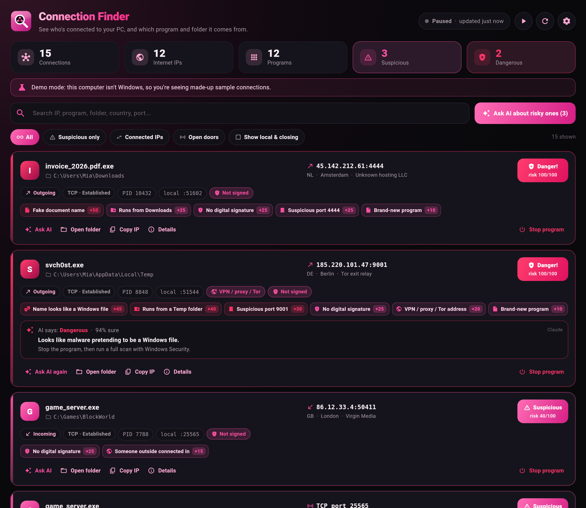

# Connection Finder 💗🖤

A pink & black Windows app that shows **which IP addresses are connected to your PC**, **which program** is behind each one (its **folder** and **file name**), and **warns you about suspicious ones**. You can also ask your own AI (ChatGPT, Claude, Gemini, DeepSeek, Grok, Mistral, OpenRouter or a local AI) for a second opinion.



## What it does

- **Live list of connections.** It refreshes every few seconds (you can pause it).
- **Program, folder and file** for every connection, for example `C:\Program Files\Google\Chrome\Application` → `chrome.exe`.
- **Who is on the other side.** Shows the country and company that owns each internet IP.
- **Suspicious connections glow pink.** Each one gets a risk score from clues like:
  - running from a sneaky folder (Temp, Downloads, Recycle Bin, hidden Windows folders)
  - no digital signature, or a broken one
  - a fake Windows name (`svchost.exe` in the wrong folder, `svch0st.exe`)
  - Windows tools that hackers misuse (PowerShell, mshta, certutil...) talking to the internet
  - hidden or encoded start-up commands
  - fake document names (`invoice.pdf.exe`)
  - hacker, Tor, crypto-mining and remote-control ports
  - VPN, proxy or Tor IPs, and countries you choose to flag
  - **20+ points = Suspicious**, **50+ points = Danger!**
- **Ask AI.** One click sends a connection's details to *your* AI using *your* API key. There is also a button that asks about all the risky ones at once.
- **Quick actions:** open the program's folder, copy the IP or path, see all the details, or stop the program.

## Download & run (no coding needed)

1. Open this repository on GitHub and click the **Actions** tab.
2. Click the newest **Build Windows app** run that has a green check ✅.
3. Scroll down to **Artifacts** and download **ConnectionFinder-Windows** (a zip file).
4. Unzip it anywhere (for example into `Documents\Connection Finder`), and double-click **ConnectionFinder.exe**.
5. Windows might say *"Windows protected your PC"*, because the app isn't signed by a company. Click **More info → Run anyway**.

**Tip:** Some programs' folders are hidden unless the app runs as administrator. Click **Restart as admin** in the app, or right-click `ConnectionFinder.exe` → **Run as administrator**.

## Setting up the AI helper

1. Click the ⚙️ **Settings** button (top right).
2. Pick your **AI company** and paste your **API key**, then click **Save key**.
3. Optional: click **Choose model** to pick from the models your key can use.
4. Click **Test connection** to make sure it works.

Your key is stored in the Windows Credential Manager on your PC. Nothing is sent to the AI until you press an **Ask AI** button. Then the app sends that connection's IP, the program's folder and file name, its start-up command and the app's clues.

The **IP lookup** (country and owner) uses the free ip-api.com service and sends only public IP addresses. You can switch it off in Settings.

> A warning is a clue, not proof of malware. When unsure, ask the AI, search for the program's name online, or scan it with Windows Security.

## For developers

Built with Flutter (Windows desktop).

```bash
flutter pub get
```

```bash
flutter test
```

```bash
flutter build windows --release
```

- `lib/services/scanner.dart`: reads connections, processes and signatures with PowerShell (`Get-NetTCPConnection`, `Get-NetUDPEndpoint`, `Win32_Process`, `Get-AuthenticodeSignature`), with `netstat -ano` as a backup.
- `lib/services/process_path.dart`: asks Windows (kernel32 `QueryFullProcessImageNameW`) for program paths that PowerShell can't see.
- `lib/services/risk_engine.dart`: the suspicion clues and points.
- `lib/services/ai_service.dart`: OpenAI-compatible, Claude (Messages API) and Gemini requests.
- `lib/services/geo_service.dart`: IP country/owner lookup.
- On non-Windows computers the app shows made-up **demo data**, which is also used for the screenshots (`CF_SCREENSHOTS=1 flutter test --update-goldens test/screenshot_test.dart`).

Every push builds the app on GitHub's Windows machines (`.github/workflows/build-windows.yml`). That build also runs a real connection scan as a test.
